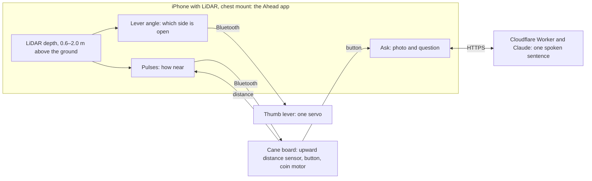

# TactileVector

A one-servo thumb cue for a white cane user, demonstrated seated and supervised. It runs two ways: in the Ahead iPhone app, which decides from the phone's LiDAR and drives the servo over Bluetooth, or as below, where an iPhone in Safari streams camera frames to a Mac. FastAPI picks a left, center or right cue and sends it over Wi-Fi to an ESP32-C3, whose servo nudges a soft lever under the thumb. Three modes: manual buttons, a green-marker tracker for bench tests, and obstacle mode (YOLO11n plus Depth Anything V2), which only cues toward a side with visible floor and stays neutral when unsure.

## How it works



Heights are above the ground; every other distance below is how far ahead. Pulses come slow when something is within 2.5 m ahead and fast within 1 m. The lever points toward the side that is measured open and stays centred for straight ahead or unsure. The Mac path (Safari camera frames to FastAPI, Wi-Fi to the lever) is drawn in [docs/DESIGN.md](docs/DESIGN.md).

## Questions judges ask

**Who is it for?** People who walk with a white cane, at the height it does not reach. Of 307 blind and legally blind adults surveyed, 13% hit something at head level at least once a month, 23% of those collisions needed medical care, and the rates were the same for cane and guide-dog users ([Manduchi & Kurniawan 2011](https://tr.soe.ucsc.edu/sites/default/files/technical-reports/UCSC-SOE-10-24.pdf)).

**Why touch and not voice?** For cane users, audio feedback on nearby obstacles carried about 22 times the workload of haptics on the cane ([Martinez et al. 2014](https://cvhci.iar.kit.edu/publications_986.php)), and the walker's ears are needed for traffic. Sound is a setting, off by default.

**How is it different from existing devices?** In a 2026 study with 13 blind or visually impaired adults, an ultrasonic clip (BuzzClip) doubled workload, 3.2 to 6.2 on NASA-TLX, partly because it gave no height information; a camera vest (NOA) cut body contacts from 2.9 to 1.6, but 8 of 13 found it too heavy or bulky at 1.3 kg ([Scientific Reports](https://pmc.ncbi.nlm.nih.gov/articles/PMC12909938/)). Ahead measures by height band, so it ignores the ground the cane already covers, and its sensor and computer are an iPhone with LiDAR (Pro models since the iPhone 12 Pro) plus two small Bluetooth boards.

**Where is the AI?** The cues while walking are fixed rules on the LiDAR depth, not a model, so the same scene always gives the same cue, and tests check it. Claude is used only on request: the cane button sends a photo and the depth readings, and the answer is one spoken sentence. The Worker refuses crossing questions and strips distances from the answer, in code as well as in the prompt, and `npm test` checks both ([worker/](worker/README.md)).

**Is it safe?** It is used with the cane. When unsure it stays silent and the lever stays centred, and the walker is told that silence does not mean the way is clear. The lever also centres when the phone loses track of its own position, 800 ms after the last command, and when Bluetooth disconnects.

**Has a blind person tested it?** No. The walk protocol is [eval/walk-protocol.md](eval/walk-protocol.md). Tests with blindfolded sighted people count as engineering data only, since they prefer different feedback than cane users do (Martinez et al. 2014).

**What have you measured?** Ask took 2.1 s round trip from a laptop; it has not been timed from the phone outdoors. On the Mac, obstacle-mode inference took about 60 ms per image after the first ([evidence/VERIFICATION.md](evidence/VERIFICATION.md)). 131 automated tests pass, including the phone's thumb cue checked against the Mac's Python on the same depth scenes. Phone-to-lever latency is not measured yet.

**What does it not cover?** Steps and drop-offs are left to the cane. Direct sun and glass are untested.

**What is next?** The first walk, an outdoor ultrasonic sensor for the cane, ranging in sun and on glass, an hour's battery and heat log, and Apple Magnifier's Detection Mode on the same route for comparison.

## Run on the phone

The Ahead app runs the LiDAR cue on the iPhone and drives the lever over Bluetooth; no Mac, tunnel or Python setup is involved:

1. Install Ahead from TestFlight (link in the table below), on an iPhone with LiDAR. The thumb lever is in builds after 0.1 (2).
2. Flash the lever's board with [firmware/thumb](firmware/thumb/README.md).
3. In the app: Settings › Thumb lever › Connect, calibrate the two angles, Done, Start.

A walk starts and stops without the screen: the Action Button, Siri ("Start Ahead"), VoiceOver's two-finger double tap, or Back Tap, after adding Ahead's Start or Stop Walk to a shortcut and picking it in Settings › Accessibility › Touch › Back Tap. The phone says which.

The phone's cue only sees from 0.6 to 2.0 m above the ground. A side counts as open only when the nearest thing in it stands more than 1.65 m ahead, so open floor with nothing behind it reads as unsure and the lever stays neutral; it also stays neutral while ARKit tracking is not normal. Manual and green-marker modes are Mac-only.

## Run on the Mac

```bash
brew install python@3.12 cloudflared
python3.12 -m venv .venv && source .venv/bin/activate
python -m pip install -r requirements-dev.lock.txt
python scripts/configure.py          # writes .env with a random TV_API_KEY, mock device
python -m pytest -q
scripts/demo.sh                      # backend + HTTPS tunnel, prints the URL phones open
```

Open the printed URL on the iPhone, or `http://127.0.0.1:8000` on the Mac, and paste `TV_API_KEY` from `.env`. Connect, Arm, hold LEFT or RIGHT, release. In mock mode the banner says **MOCK DEVICE** and no servo moves.

Safari needs an HTTPS origin for camera, microphone and speech, which is what the tunnel provides; it needs no Cloudflare account. The URL changes each run. For the lowest frame latency use the LAN with a locally trusted certificate instead: [docs/SETUP_MAC.md](docs/SETUP_MAC.md).

Obstacle mode needs the models once: `pip install -r requirements-perception.txt && python -m scripts.prepare_vision`. Options live in `.env` (`TV_OBSTACLE_ENGINE`, `TV_MODEL_DEVICE`); defaults and the upgrade path for an existing install are in [MIGRATION.md](MIGRATION.md).

## Hardware

1. Verify rails, connector orientation, GPIO and servo power: [docs/HARDWARE.md](docs/HARDWARE.md).
2. Flash with the horn off, calibrate `TV_LEFT`/`TV_RIGHT`: [docs/FIRMWARE.md](docs/FIRMWARE.md).
3. Set `TV_DEVICE=esp32`, its IP and token in `.env`, restart, test manual cues.
4. Run the [acceptance checks](docs/ACCEPTANCE.md) and record what happened.

The firmware emits no PWM until the GPIO is set in an ignored local `config.h`.

How a cue is decided, the API and the repository layout: [docs/DESIGN.md](docs/DESIGN.md).

This is a controlled cue demonstrator, not a navigation aid or a safety system.

## Ahead, a parallel design

Ahead covers chest and head height, where a cane does not reach: iPhone LiDAR in a chest mount felt as pulses (silent beyond 2.5 m, slow within 2.5 m, fast within 1 m), an upward distance sensor on the cane over Bluetooth, and a photo described aloud on request.

| Part | Where |
| --- | --- |
| `research/` | the brief, four model reports, and `handoff.md` with the synthesis and which claims were checked against primary sources |
| `eval/` | walking protocol, sensor bench log, NASA-TLX, and `analyze.py` for the CSV the app exports |
| `worker/` | the Cloudflare Worker behind Ask: photo plus LiDAR readings in, one spoken sentence out; `npm test` checks the two rules offline; `npx wrangler deploy` |
| `ios/Ahead/` | the iPhone app's page, its whole interface; TestFlight https://testflight.apple.com/join/RuyPSTNZ. The native shell is the `Ahead` target of jonasneves/phone-bridge (private, ask for access) |
| `firmware/cane/` | the cane's ESP32 firmware: a BLE peripheral with an upward distance sensor, a button and a coin motor; pins, GATT and fail-safes in its README |
