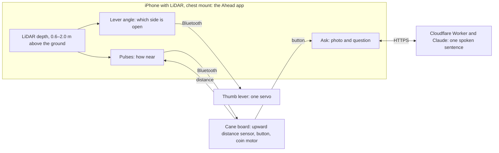

# AHEAD

[](https://testflight.apple.com/join/RuyPSTNZ) [](https://aheadcane.github.io/)

Ahead is an iPhone app for people who walk with a white cane. The phone sits in a chest mount and reads what is at chest and head height with its LiDAR sensor, where the cane does not reach, and gives a vibration cue. An optional board on the cane adds a buzz in the grip and a thumb lever.

## What it does

- **Pulses by distance.** The phone pulses slowly when something stands within 2.5 m ahead and fast within 1 m, and stays silent beyond that. The cane's grip buzzes only within 0.5 m, from the phone's reading or from its own upward distance sensor.
- **A thumb lever for the open side.** The lever points toward the side that is measured open and stays centred for straight ahead or unsure.
- **A spoken answer to a question.** Hold the ask button in the app, or the button on the cane, and ask, for example, "what does the sign say". The photo, the phone's distance readings and the question go to a Cloudflare Worker and Claude, and the phone speaks one sentence. The answer can be wrong.



Heights are above the ground; every other distance in this file is how far ahead.

## Limits

This is a controlled cue demonstrator, not a navigation aid or a safety system. The thumb lever has been demonstrated seated and supervised; the cane board's button and its 0.5 m buzz are not yet checked by hand ([firmware/cane](firmware/cane/README.md)). Ahead is in a beta and only a few people have walked with it so far.

Ahead is an extra cue and never replaces your cane or your own judgement. It can miss things such as glass, thin poles, steps and drops, and it never tells you whether to cross a street. Silence does not mean the way is clear.

## Try it

Install Ahead from [TestFlight](https://testflight.apple.com/join/RuyPSTNZ). It needs an iPhone with LiDAR, a 12 Pro or a later Pro model, and iOS 26 for asking by voice. The cane board and the thumb lever are optional. Help and the privacy policy: [aheadcane.github.io](https://aheadcane.github.io/).

## Run on the phone with the cane board

The Ahead app runs the LiDAR cue on the iPhone and drives the lever over Bluetooth; no Mac, tunnel or Python setup is involved:

1. Install Ahead as above. The thumb lever is in builds after 0.1 (2).
2. Flash the board: `devkit-vl53l0x-thumb` in [firmware/cane](firmware/cane/README.md) puts the cane and the lever on one ESP32 DevKit V1 (servo on GPIO 26); [firmware/thumb](firmware/thumb/README.md) is the lever alone.
3. Open the app. It finds the cane by itself: one cane in range connects, several give a list, nearest first. Each board is named by a short code from its Bluetooth address (`Cane C9D2`), shown in the pill at the top. A board the app has used reconnects at launch and after a dropped link; turning it off in Settings keeps it off.
4. Settings › Thumb lever: calibrate the two angles (78 and 102 by default, about 12° each way), Done, Start. A lever on its own `Thumb` board is connected here the first time.

A walk starts and stops without the screen: the Action Button on a 15 Pro or later, Siri ("Start Ahead"), VoiceOver's two-finger double tap, or Back Tap, after adding Ahead's Start or Stop Walk to a shortcut and picking it in Settings › Accessibility › Touch › Back Tap. The phone says which.

The phone's cue only sees from 0.6 to 2.0 m above the ground. A side counts as open only when the nearest thing in it stands more than 1.65 m ahead, so open floor with nothing behind it reads as unsure and the lever stays neutral; it also stays neutral while ARKit tracking is not normal. Manual and green-marker modes are Mac-only.

## Run on the Mac

TactileVector is the name the code uses for the Mac path, the same thumb lever driven without the app: an iPhone in Safari streams camera frames to a Mac, FastAPI picks a left, center or right cue and sends it over Wi-Fi to an ESP32, whose servo moves the lever. Three modes: manual buttons, a green-marker tracker for bench tests, and obstacle mode (YOLO11n plus Depth Anything V2), which only cues toward a side with visible floor and stays neutral when unsure.

```bash
brew install python@3.12 cloudflared
python3.12 -m venv .venv && source .venv/bin/activate
python -m pip install -r requirements-dev.lock.txt
python scripts/configure.py          # writes .env with a random TV_API_KEY, mock device
python -m pytest -q
scripts/demo.sh                      # backend + HTTPS tunnel, prints the URL phones open
```

Open the printed URL on the iPhone, or `http://127.0.0.1:8000` on the Mac, and paste `TV_API_KEY` from `.env`. Connect, Arm, hold LEFT or RIGHT, release. In mock mode the banner says **MOCK DEVICE** and no servo moves.

Safari needs an HTTPS origin for camera, microphone and speech, which is what the tunnel provides; it needs no Cloudflare account. The URL changes each run. For the lowest frame latency use the LAN with a locally trusted certificate instead: [docs/SETUP_MAC.md](docs/SETUP_MAC.md).

Obstacle mode needs the models once: `pip install -r requirements-perception.txt && python -m scripts.prepare_vision`. Options live in `.env`: `TV_OBSTACLE_ENGINE` (`neural`, the default, or `opencv`) and `TV_MODEL_DEVICE` (`cpu`, the default, or `mps`).

### Hardware for the Mac path

1. Verify rails, connector orientation, GPIO and servo power: [docs/HARDWARE.md](docs/HARDWARE.md).
2. Flash with the horn off, calibrate `TV_LEFT`/`TV_RIGHT`: [docs/FIRMWARE.md](docs/FIRMWARE.md).
3. Set `TV_DEVICE=esp32`, its IP and token in `.env`, restart, test manual cues.
4. Run the [acceptance checks](docs/ACCEPTANCE.md) and record what happened.

The firmware emits no PWM until the GPIO is set in an ignored local `config.h`.

How a cue is decided on the Mac path, the API and the Mac path's folders: [docs/DESIGN.md](docs/DESIGN.md).

## Repository layout

| Path | What it holds |
| --- | --- |
| `eval/` | walking protocol, sensor bench log, NASA-TLX, and `analyze.py` for the CSV the app exports |
| `worker/` | the Cloudflare Worker behind Ask: photo plus LiDAR readings in, one spoken sentence out; `npm test` checks the two rules offline; `npx wrangler deploy` |
| `ios/Ahead/` | the iPhone app's page, its whole interface; TestFlight https://testflight.apple.com/join/RuyPSTNZ. The native shell is the `Ahead` target of jonasneves/phone-bridge (private, ask for access) |
| `firmware/cane/` | the cane's ESP32 firmware: a BLE peripheral with an upward distance sensor, a button and a coin motor, and optionally the thumb lever's servo; pins, GATT and fail-safes in its README |
| `firmware/thumb/` | the thumb lever alone as a BLE peripheral, and `Thumb.h`, the servo service the cane firmware also carries |
