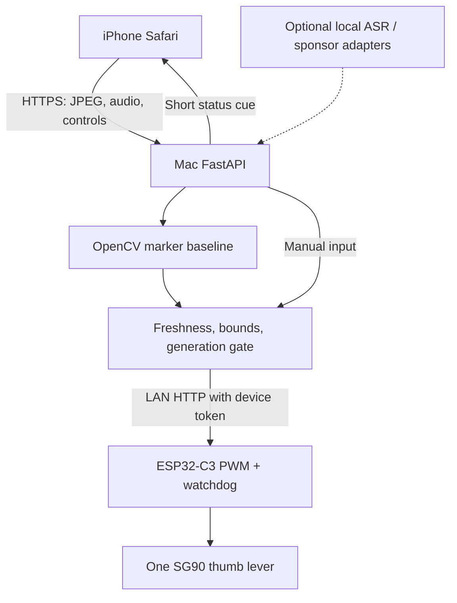

> **Obstacle upgrade:** Start with [MIGRATION.md](MIGRATION.md). See docs/UPGRADE_AUDIT.md and docs/SPONSOR_SETUP.md for current capabilities. The original baseline documentation below is retained for compatibility; statements that neural vision and sponsor wiring are absent describe the prior version.

# TactileVector

**A working software prototype for a stationary, sighted, supervised one-servo thumb-cue demo.**
An iPhone sends camera frames to a Mac. FastAPI chooses a left/center/right cue and sends it over Wi-Fi to an ESP32-C3. The servo nudges a soft thumb lever on a removable sleeve around the cylindrical Anker battery.

**Start with [START_HERE.md](START_HERE.md).** Hardware-independent simulation works immediately after Python setup. Physical actuation requires verified servo power, an identified signal GPIO, flashing, and the checklist below. The shipped firmware deliberately outputs no PWM until those checks are acknowledged in an ignored local config.

The complete original Gemini transcript was retrieved and read during this Work task (697 reader lines, originally described as 696). See [spec audit](docs/SPEC_AUDIT.md) and [original text](docs/GEMINI_ORIGINAL.txt). Its final one-servo design is retained. Unsafe wiring assumptions, blindfolded demos, invented availability, and unmeasured performance claims are corrected explicitly.

## What is implemented

| Layer | Included | Limits |
|---|---|---|
| ESP32-C3 | Arduino 3.x LEDC PWM, `/steer?angle=X`, token, `/health`, strict 75–105 command bounds, 90 neutral, independent 800 ms timeout task, Wi-Fi-loss neutral | GPIO unset; board/shield unverified; physical angle is not measured |
| Python | FastAPI, authenticated control, mock/HTTP device drivers, stale-frame rejection, generation fencing, 700 ms input lease | One process, one operator; no multiworker deployment |
| Vision | OpenCV colored-target L/C/R baseline, red exclusion, two-frame confirmation, neutral on uncertainty | Controlled tabletop markers, not obstacle avoidance or a traversability estimator |
| iPhone | Same-origin camera JPEG upload, rear-camera preference, microphone recording, large hold-to-record, hold-to-nudge, Stop, clock-face speech | Safari trusted HTTPS required; real iPhone permissions must be tested |
| Voice | Local deterministic status/clock cues, Safari speech synthesis, audio transport; optional local Whisper input adapter | Default capture does not transcribe; no door/object recognition; ASR never actuates |
| Sponsors | Tinker boundary with explicit unconfigured failure; verified-contract Informer sender | No sponsor credentials, training, dashboard deployment, or delivery performed |
| Verification | Python tests, simulated ESP32 HTTP integration, C++ policy test, browser smoke script | See [actual results](evidence/VERIFICATION.md) for exact scope |

## Five-minute software start (Mac)

From the extracted `tactilevector` folder:

```bash
brew install python@3.12
python3.12 -m venv .venv
source .venv/bin/activate
python -m pip install -r requirements-dev.lock.txt
python scripts/configure.py
python -m pytest -q
python -m uvicorn backend.app:create_app --factory --host 127.0.0.1 --port 8000
```

Open `http://127.0.0.1:8000` on the Mac. Open `.env` locally and paste `TV_API_KEY` into the interface; it is not a sponsor API key. Connect → Arm → promptly hold LEFT or RIGHT → release. The banner says **MOCK DEVICE**. Stop/release disarms; arm again for the next cue. Input inactivity also disarms. No servo is controlled in mock mode.

For iPhone, follow [trusted HTTPS and Mac setup](docs/SETUP_MAC.md). Plain `http://<Mac-IP>` is not a camera origin on iPhone. `localhost` on iPhone means the iPhone itself.

## Build order

1. Software mock → [Mac/HTTPS guide](docs/SETUP_MAC.md).
2. Verify rails, connector orientation, GPIO, and power arrangement → [hardware guide](docs/HARDWARE.md).
3. Compile/flash without horn contact, calibrate → [firmware steps](docs/FIRMWARE.md).
4. Set `TV_DEVICE=esp32`, match its IP/token, restart Python; test manual cues.
5. Show a green target in one camera lane; camera → Python → Wi-Fi → servo.
6. Run every [physical acceptance check](docs/ACCEPTANCE.md); record actual results.
7. Add voice/optional models/sponsors only after the base demo → [extensions](docs/EXTENSIONS.md).

## Data flow and control



The phone never contacts the ESP32 directly, avoiding HTTPS-to-HTTP mixed content. The controller serializes actuator writes. A Stop increments a generation; an in-flight old camera decision cannot override it. Two stable marker frames are needed to move; an unknown/changed target goes neutral immediately. Backend input expiry disarms; ESP32 expiry independently requests neutral. Neutral still applies servo holding torque and cannot clear a mechanical jam or power failure. Unplug accessible servo power for a jam.

## API

All `/api/*` endpoints require `X-API-Key`. The public `/health` only identifies the service/mode. There is no permissive CORS. Firmware `/steer` requires `X-Device-Token` and exactly one integer `angle` query. GET is retained to match Gemini; responses use `no-store`.

| Method/path | Body | Behavior |
|---|---|---|
| GET `/api/status` | — | State, mode, generation, last ACK age; ACK is not measured shaft position |
| POST `/api/arm` | `{"mode":"manual"}` or `{"mode":"cv"}` | Health check + neutral ACK, new generation |
| POST `/api/steer` | `{"direction":"left","generation":1}` | Fresh manual cue; valid directions left/center/right |
| POST `/api/stop` | `{}` | Invalidate prior inputs, request neutral, disarm |
| POST `/api/frame?generation=1&sequence=0` | Raw `image/jpeg` | Up to 400 kB, bounded dimensions, monotonic sequence, no queue |
| POST `/api/voice` | `{"text":"status"}` | Short rule-based cue; no actuation |
| POST `/api/audio` | Raw audio/mp4 or negotiated WebM/Ogg | Up to 1 MB; optional ASR; default capture receipt, no storage |

`401` means missing/wrong token; `409` stale/disarmed/wrong mode; `413` too large; `415` unsupported content type; `422` invalid image/body; `429` busy/drop frame; `503` device failure. A failed neutral write is shown as **unconfirmed**, never as physical success.

## Repository map

- `backend/`: settings, vision, device transport, control state, HTTP app, optional adapters.
- `web/`: phone interface; no build system or external CDN required.
- `firmware/TactileVector/`: sketch, safety policy, example config.
- `scripts/`: configure, local simulator, HTTP smoke test, browser smoke, verification and packaging.
- `tests/`: hardware-independent test suite and C++ policy checks.
- `docs/`: wiring, calibration, HTTPS, acceptance, transcript audit, sources, weekend roadmap.
- `evidence/`: real test/build output and the distinction between tested and pending.

No device power, latency, efficacy, accessibility certification, price, prize eligibility, or sponsor result is asserted from simulation. This is not a navigation aid for blindfolded walking or a safety system. It does not establish novelty against commercial assistive products.

## Ahead, a parallel design (Jonas)

Built over the same two days, in Jonas's own repos; these folders are here so anyone on the team can edit them. Ahead
watches chest and head height, where a cane does not reach: iPhone LiDAR in a chest mount, felt as pulses (silent
beyond 2.5 m, slow within 2.5 m, fast within 1 m); an ultrasonic sensor on the cane pointing up at head height, over
Bluetooth; a photo described aloud on request. Two rules from the research below: the cloud never says whether to
cross a street, and never speaks a distance (the LiDAR's own distance is spoken instead).

| Part | Where | What it is |
| --- | --- | --- |
| `research/` | here | one brief put to four AI models (Codex, Gemini, Claude, Cursor), their four reports, and `handoff.md`: the synthesis, with which claims were checked against primary sources and which were not |
| `eval/` | here | a walking test protocol, a sensor bench-log template, the NASA-TLX workload questionnaire, and `analyze.py`, which summarizes the CSV the app exports after a walk |
| `worker/` | here | the Cloudflare Worker behind the app's Ask button: the phone sends a photo and the LiDAR readings, Claude returns one spoken sentence. The two rules above are enforced in code and `npm test` checks them offline. Deployed today from Jonas's Cloudflare account; `npx wrangler deploy` puts it on anyone's |
| iPhone app | TestFlight: https://testflight.apple.com/join/RuyPSTNZ, live once Apple's beta review clears | source in jonasneves/phone-bridge, private; ask Jonas for read access |
| Cane firmware | jonasneves/esp32-labs, `cane/`, private; ask for read access | ESP32-C3 SuperMini, JSN-SR04T ultrasonic, coin motor under the index finger, one button; the Bluetooth contract is in its README |

