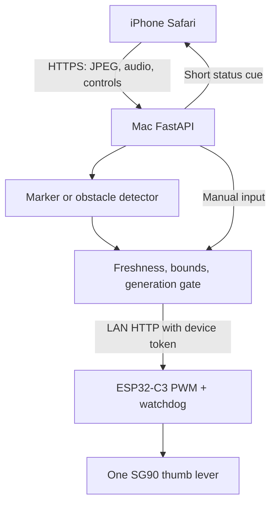

# TactileVector

A one-servo thumb cue for a white cane user, demonstrated seated and supervised. An iPhone in Safari streams camera frames to a Mac. FastAPI picks a left, center or right cue and sends it over Wi-Fi to an ESP32-C3, whose servo nudges a soft lever under the thumb. Three modes: manual buttons, a green-marker tracker for bench tests, and obstacle mode (YOLO11n plus Depth Anything V2), which only cues toward a side with visible floor and stays neutral when unsure.

## Run

```bash
brew install python@3.12 cloudflared
python3.12 -m venv .venv && source .venv/bin/activate
python -m pip install -r requirements-dev.lock.txt
python scripts/configure.py          # writes .env with a random TV_API_KEY, mock device
python -m pytest -q
scripts/demo.sh                      # backend + HTTPS tunnel, prints the URL phones open
```

Open the printed URL on the iPhone, or `http://127.0.0.1:8000` on the Mac, and paste `TV_API_KEY` from `.env`. Connect, Arm, hold LEFT or RIGHT, release. In mock mode the banner says **MOCK DEVICE** and no servo moves.

Safari needs an HTTPS origin for camera, microphone and speech, which is what the tunnel provides; it needs no Cloudflare account. The URL changes each run. For the lowest frame latency use the LAN with a locally trusted certificate instead: [docs/SETUP_MAC.md](docs/SETUP_MAC.md).

Obstacle mode needs the models once: `pip install -r requirements-perception.txt && python -m scripts.prepare_vision`. Options live in `.env` (`TV_OBSTACLE_ENGINE`, `TV_MODEL_DEVICE`); defaults and the upgrade path for an existing install are in [MIGRATION.md](MIGRATION.md).

## Hardware

1. Verify rails, connector orientation, GPIO and servo power: [docs/HARDWARE.md](docs/HARDWARE.md).
2. Flash with the horn off, calibrate `TV_LEFT`/`TV_RIGHT`: [docs/FIRMWARE.md](docs/FIRMWARE.md).
3. Set `TV_DEVICE=esp32`, its IP and token in `.env`, restart, test manual cues.
4. Run the [acceptance checks](docs/ACCEPTANCE.md) and record what happened.

The firmware emits no PWM until the GPIO is set in an ignored local `config.h`.

## How a cue is decided



The phone never talks to the ESP32. Stop increments a generation, so an in-flight camera decision cannot override it. Obstacle mode needs three consistent frames to move; an uncertain scene goes neutral at once. Input older than 700 ms (1.6 s in obstacle mode) disarms the backend, and the ESP32 independently returns to neutral after 800 ms without a command. Neutral still holds torque: unplug servo power to clear a jam.

## API

Every `/api/*` route requires `X-API-Key`; `/health` is public. Firmware `/steer?angle=` requires `X-Device-Token` and accepts 75 to 105.

| Route | Body | Does |
|---|---|---|
| GET `/api/status` | | state, mode, generation, last ACK age |
| POST `/api/arm` | `{"mode":"manual"\|"cv"\|"obstacle"}` | health check, neutral, new generation |
| POST `/api/steer` | `{"direction":"left","generation":1}` | manual cue |
| POST `/api/stop` | `{}` | neutral, disarm, invalidate earlier input |
| POST `/api/frame?generation=&sequence=` | `image/jpeg` ≤ 400 kB | one frame, no queue |
| POST `/api/voice` | `{"text":"status"}` | spoken status, never actuates |
| POST `/api/audio` | audio ≤ 1 MB | optional local Whisper, see [docs/EXTENSIONS.md](docs/EXTENSIONS.md) |

`401` bad key, `409` stale or wrong mode, `413`/`415`/`422` bad frame, `429` busy, `503` device unreachable. A failed neutral write shows as **unconfirmed**, never as success.

## Repository

- `backend/` FastAPI, detectors, device transport, control state
- `web/` the phone page, no build step
- `firmware/TactileVector/` sketch, safety policy, example config
- `scripts/` configure, demo, ESP32 simulator, smoke tests, model preparation
- `tests/`, `evidence/` the test suite and what it actually proved
- `docs/` wiring, flashing, HTTPS, acceptance, sources, roadmap

This is a controlled cue demonstrator, not a navigation aid or a safety system.

## Ahead, a parallel design (Jonas)

Ahead covers chest and head height, where a cane does not reach: iPhone LiDAR in a chest mount felt as pulses (silent beyond 2.5 m, slow within 2.5 m, fast within 1 m), an upward ultrasonic sensor on the cane over Bluetooth, and a photo described aloud on request. Two rules from the research: the cloud never says whether to cross a street and never speaks a distance.

| Part | Where |
| --- | --- |
| `research/` | the brief, four model reports, and `handoff.md` with the synthesis and which claims were checked against primary sources |
| `eval/` | walking protocol, sensor bench log, NASA-TLX, and `analyze.py` for the CSV the app exports |
| `worker/` | the Cloudflare Worker behind Ask: photo plus LiDAR readings in, one spoken sentence out; `npm test` checks the two rules offline; `npx wrangler deploy` |
| iPhone app | TestFlight https://testflight.apple.com/join/RuyPSTNZ; source in jonasneves/phone-bridge (private, ask Jonas) |
| Cane firmware | jonasneves/esp32-labs `cane/` (private, ask Jonas): ESP32-C3 SuperMini, JSN-SR04T, coin motor, one button |
