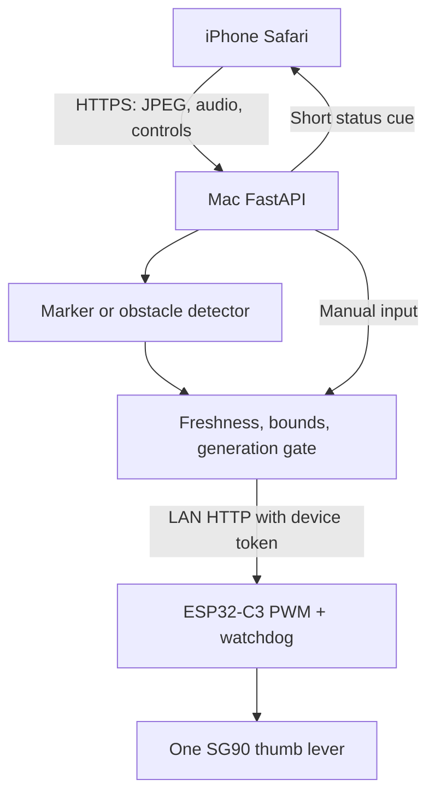

# Design: how a cue is decided, the API, the repository

## How a cue is decided

On this path the phone never talks to the ESP32. On the phone path the Ahead app makes the same decision from its LiDAR corridor and writes the angle to [firmware/thumb](../firmware/thumb/README.md) over Bluetooth; the differences are listed above the cue in `ios/Ahead/index.html` and checked by `tests/test_thumb_cue.py`. Stop increments a generation, so an in-flight camera decision cannot override it. Obstacle mode needs three consistent frames to move; an uncertain scene goes neutral at once. Input older than 700 ms (1.6 s in obstacle mode) disarms the backend, and the ESP32 independently returns to neutral after 800 ms without a command. Neutral still holds torque: unplug servo power to clear a jam.

## API

Every `/api/*` route requires `X-API-Key`; `/health` is public. Firmware `/steer?angle=` requires `X-Device-Token` and accepts 60 to 120.

| Route | Body | Does |
|---|---|---|
| GET `/api/status` | | state, mode, generation, last ACK age |
| POST `/api/arm` | `{"mode":"manual"\|"cv"\|"obstacle"}` | health check, neutral, new generation |
| POST `/api/steer` | `{"direction":"left","generation":1}` | manual cue |
| POST `/api/stop` | `{}` | neutral, disarm, invalidate earlier input |
| POST `/api/frame?generation=&sequence=` | `image/jpeg` ≤ 400 kB | one frame, no queue |
| POST `/api/voice` | `{"text":"status"}` | spoken status, never actuates |
| POST `/api/audio` | audio ≤ 1 MB | optional local Whisper, see [docs/EXTENSIONS.md](EXTENSIONS.md) |

`401` bad key, `409` stale or wrong mode, `413`/`415`/`422` bad frame, `429` busy, `503` device unreachable. A failed neutral write shows as **unconfirmed**, never as success.

## Repository

- `backend/` FastAPI, detectors, device transport, control state
- `web/` the phone page, no build step
- `firmware/TactileVector/` sketch, safety policy, example config
- `firmware/thumb/` the same servo as a BLE peripheral for the Ahead app, which decides the cue on the phone
- `ios/Ahead/` Ahead's app page, bundled by phone-bridge's `Ahead` target
- `firmware/cane/` Ahead's cane board: PlatformIO, ESP32-C3 or DevKit V1, BLE peripheral
- `scripts/` configure, demo, ESP32 simulator, smoke tests, model preparation
- `tests/`, `evidence/` the test suite and what it actually proved
- `docs/` wiring, flashing, HTTPS, acceptance, sources, roadmap
