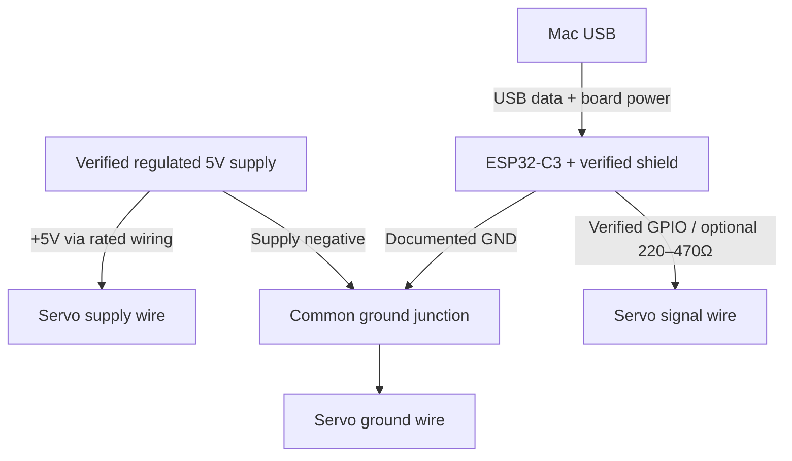

# Parts, wiring, and mounting

## Inventory: ownership is not inferred from checkboxes

| Item | Quantity | Status / purpose |
|---|---:|---|
| ESP32-C3 SuperMini + expansion shield | 1 | Reported present; exact PCB revision and rail routing unverified |
| Positional SG90-style servo + horn + screw | 1 | Present tonight; confirm positional, not continuous rotation |
| Cylindrical Anker power bank | 1 | Present; exact model/output/current/auto-off behavior must be read from label |
| Mac laptop + iPhone | 1 each | Present; laptop runs backend, phone camera/mic |
| USB data cable fitting ESP32 | 1 | Verify data capability; charge-only cables cannot flash |
| Jumper leads / insulated connectors | As needed | Reported present; match gender; use rated power wiring, not flimsy signal leads for high current |
| Resistors | Optional | Reported present; 220–470Ω signal series resistor optional, not a voltage regulator |
| Verified regulated 5V servo supply | 1 | Required; bank may qualify only after capacity and connection verification |
| Suitable USB power breakout / rated distribution hardware | As needed | NOT confirmed; needed if no verified accessible servo 5V rail |
| Multimeter | 1 | NOT confirmed; borrow for voltage/continuity checks |
| Padded sleeve, Velcro straps, small rigid mounting plate | 1 set | NOT confirmed; practical removable mounting materials |
| Green card + red card | 1 each | Controlled vision-demo target and exclusion marker |
| 470–1000µF capacitor rated ≥10V | Optional | NOT confirmed; helps transient suppression, not a fix for undersized power |
| Pushbutton / piezo buzzer | Optional | Presence/type unconfirmed; firmware omits them; phone covers both interactions |
| Raspberry Pi / HC-SR04 / second servo | 0 required | Optional later; not a dependency |

A checked Co-Lab item meant unavailable at Co-Lab, not “owned.” Do not promote Gemini's speculative kit inventory into a parts-on-table claim.

## Identify the board and shield before connecting the servo

1. Disconnect USB, battery, and servo. Photograph both sides and read part/revision markings. Locate the exact vendor schematic/pinout matching that revision. ESP32-C3 chip documentation does not describe an arbitrary expansion shield.
2. Find explicit **GND**, **5V/VBUS/VIN**, **3V3**, and **GPIO/IO numbers** on the board. Colors alone are not pin identification. “VCC” could mean 3.3V, 5V, or a separately fed rail.
3. With power OFF, use continuity mode to trace a shield GND to a documented board GND; trace a proposed signal contact to its documented GPIO. Inspect rail-selection jumpers. Never use continuity mode on a powered board.
4. Determine from the shield schematic whether its servo supply is connected to USB VBUS, 3V3, an external terminal, or a selector. If not clear, leave its power pins unused and route servo power separately.
5. Power only the ESP32 through its intended USB port. With the servo disconnected, use DC voltage mode between verified GND and the proposed supply. Confirm polarity and voltage. Keep probe tips from bridging adjacent contacts. Disconnect again before wiring.
6. Select a **documented, exposed output GPIO** not shared with onboard devices. This project sets `SERVO_PIN=-1`; no final signal pin has been chosen. C3 GPIO2/8/9 are boot-strapping pins; 18/19 are USB. Flash/power-related and UART pins are also excluded by the example firmware. The remaining chip GPIOs are not automatically proven safe on your board.
7. Record the measured rail, GPIO, board revision and supply rating in the acceptance worksheet. Only then set `PIN_VERIFIED=true` and `POWER_VERIFIED=true` locally.

If there is no multimeter, matching documentation, or safe 5V terminal access tonight, continue in mock mode and finish those checks at the Co-Lab. Do not discover a power rail by trial-and-error plugging.

## Recommended first bench wiring: two supplies, shared ground

Power ESP32 from the laptop's USB **data cable**, and the servo from a **separate verified 5V supply**. The Anker bank can be that servo supply only with a rated breakout/connector and verified output capability. This needs one usable bank output, not two. It keeps flashing simple and avoids routing servo surge current through unverified PCB traces.

**Do not join the servo +5V to the board's 3V3 rail. Do not tie two separate +5V sources together.** Only grounds are joined in this bench arrangement. Never put 5V onto a GPIO. A signal series resistor is optional protection, not a level shifter; if your servo clone does not recognize 3.3V control, use a proper documented unidirectional buffer, not a pull-up to 5V on ESP32.

| Servo connection | Connect to | Verification |
|---|---|---|
| Supply, commonly red | Verified regulated 5V servo source | Confirm actual servo connector/spec, not color alone |
| Ground, commonly brown/black | Supply negative + ESP32 documented GND | Common reference required |
| Control, commonly orange/yellow/white | Verified GPIO, optionally via 220–470Ω | Set same physical GPIO in local `config.h` |

Keep power leads short and secure. Do not rely on a loose breadboard contact for large surge current. If adding the optional electrolytic capacitor, place it across servo 5V/GND near the connector with correct polarity and ≥10V rating. Disconnect before adding it.

## Single-bank grip power, after bench validation

A self-contained grip remains the target. Choose **one** supported arrangement after checking hardware:

- A verified shield has a **5V servo rail explicitly rated for the load** from its USB input: bank → normal USB input → documented servo rail. Verify rail selector, trace/connector rating, and loaded voltage. A header marked 5V alone does not prove current capacity.
- A **proper rated 5V distribution breakout** splits the bank's single output into a protected USB feed to ESP32 and a separate servo feed, with common ground. Do not use an unverified USB Y cable or expose wires from a normal USB-C cable. Avoid feeding an external board pin while USB is connected unless the exact board supports this without backfeeding.

If neither is verified, retain the two-supply bench demo. Do not assume a second bank output, USB-C power-role behavior, or pass-through charging. Do not power ESP32/servo from the iPhone. Do not simultaneously back-power the laptop USB from an external rail.

**Current:** SG90 clones vary substantially. Tower Pro's own page lists external supply and notes high operating-current demand; treat **5V, 2A capacity for the servo branch as a conservative design target**, then validate the actual servo and supply. If sharing power, allow additional ESP32 headroom. This is not a measured current requirement of your unit. A nominally adequate bank can still sag through a poor cable, auto-shutoff at low load, or trip on a stalled servo. Never hold a servo stalled to test current. Reset messages, jitter, disconnects, or buzzing mean stop, unload, and investigate supply/mechanics. Neutral cannot be guaranteed during lost power.

## Mounting: removable module, one axis

1. Begin with the servo loose on the bench and **horn removed**. Verify neutral PWM and logical left/right movement before attaching any lever.
2. Make a padded sleeve around the cylinder using Velcro or soft rubber plus a small rigid plate. Secure the ESP32 to insulated standoffs or an insulated pouch; no exposed solder pads against a metal shell.
3. Attach the servo **body** to the mounting plate with its intended mounting ears/fasteners or straps. Keep fasteners entirely in the plate. No drilling, screws, hot glue, or heat into the battery case. Leave bank ports, button and labels accessible.
4. At commanded neutral, power off and fit the horn with its small retaining screw so its travel is centered under a resting thumb. Add a short, soft, rounded paddle or foam cap. No sharp edges, finger loops, exposed gear pinch points, or lever that traps the thumb. Do not force the shaft by hand.
5. Choose the servo shaft orientation so the horn sweeps left/right across the pad of the thumb. Verify actual direction visually. If reversed, swap only `TV_LEFT` and `TV_RIGHT`; do not reverse supply polarity. Start with 84/96 logical commands (about ±6°), expand gradually to the 78/102 default (about ±12°) only if unloaded travel is unobstructed. Hard firmware bounds are 60–120.
6. Keep neutral physically non-pressing. A positional servo has no force sensor; small angles do not imply safe force. The user must be able to lift the thumb off at any instant. Stop if the horn binds, buzzes, gets hot, or presses painfully.
7. Strain-relieve the wires to the plate. Keep servo power disconnect accessible to the supervising person. Confirm none of the wires can enter the lever sweep.
8. Support the phone separately for initial testing. Add it to a proper phone cradle/strap only after load balance and grip stability are checked. Do not rely on adhesive directly on a slippery cylinder to hold an expensive phone.
9. Attach the module to a stationary cane/cart/walker handle only as a mounting demonstration. Do not impair the original handle's grip or load-bearing function. No blindfolded or unsupervised walking.

Exact printable clamp dimensions are intentionally not fabricated: measure cylinder diameter, servo body/ears, phone case, strap width, and thumb reach first. A taped/strapped removable sleeve is tonight's build; a measured CAD mount is Saturday work.
